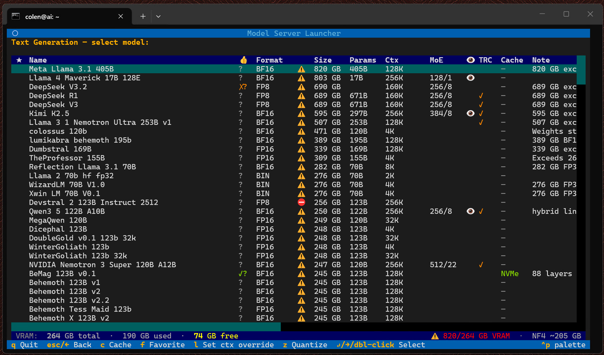
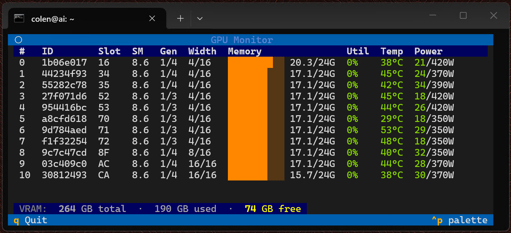

# ai-server-tools

> [!WARNING]
> **This project is under active development and is not yet stable.** Interfaces, data formats, and configuration may change without notice. Not recommended for production use.

> [!NOTE]
> **Note: Much of the code in this repository is AI-generated under close human direction. Design decisions are human-driven.**

A toolkit for viewing GPU status and managing AI models and model servers on an NVIDIA multi-GPU workstation or server. Includes a keyboard-driven TUI launcher for spinning up inference servers and a standalone GPU stats monitor.

## Tools

### [Launcher](launcher/README.md)
A keyboard-driven Textual TUI for selecting and launching AI model inference servers (vLLM, llama.cpp, tabbyAPI / ExLlamaV2, SGLang, ComfyUI, and more). Features live VRAM readout, per-model/per-server test-result tracking, remote-to-local model caching, and in-TUI quantization.



### [GPU Monitor](gpu_monitor/README.md)
A full-screen live GPU stats display — per-GPU VRAM, utilization, temperature, power, and PCIe topology. Adaptive polling: fast (0.1 s) while active, slow (1.0 s) at idle. Useful to watch VRAM fill as a large model loads.



## Requirements

- Linux, NVIDIA GPUs with a compatible driver (NVML required)
- [Miniconda](https://docs.conda.io/en/latest/miniconda.html) or Anaconda

## Shared setup

Both tools use a single shared conda environment defined at the repo root:

```bash
conda env create -f ~/ai-server-tools/environment.yml
```

This installs Python 3.11, `textual`, and `nvidia-ml-py`. The AI model servers (vLLM, tabbyAPI, etc.) each have their own separate conda environments — see [launcher/README.md](launcher/README.md) for details.

For IDE type-checking (Pyright / Pylance), copy the example config and set your conda path:

```bash
cp pyrightconfig.json.example pyrightconfig.json
# Edit pyrightconfig.json and set venvPath to your miniconda3/envs directory
```

For Copilot context, copy the system instructions template and fill in your machine details:

```bash
cp .github/instructions/system-local.instructions.md.example .github/instructions/system-local.instructions.md
# Edit system-local.instructions.md with your host, GPU specs, and storage paths
```

## Quick start

```bash
# Launcher
cd ~/ai-server-tools
~/miniconda3/envs/ai-tools/bin/python -m launcher

# GPU Monitor (run alongside the launcher in a separate terminal)
cd ~/ai-server-tools
~/miniconda3/envs/ai-tools/bin/python -m gpu_monitor
```

Or with convenience scripts — see each tool's README.

## Repo layout

```
environment.yml          Shared conda environment (launcher + gpu_monitor)
launcher/                TUI model launcher — see launcher/README.md
gpu_monitor/             Live GPU stats — see gpu_monitor/README.md
user_data/               Gitignored — personal local data (caches, audit log)
logs/                    Gitignored — server session logs
```

## License

TBD. All rights reserved.
